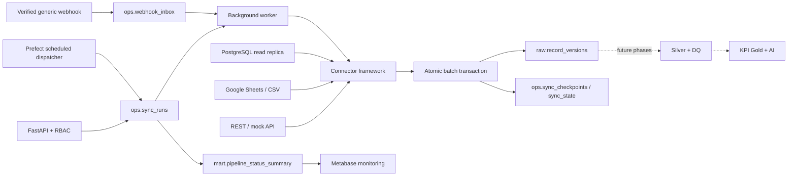

> Cập nhật 16/10/2026: bản chạy hiện tại là [demo Vercel](https://cdip-business-demo.vercel.app).
> Xem [vận hành hiện tại](operations.md). Các phần database, nguồn dữ liệu và lưu dùng chung bên dưới mô tả backend được giữ lại để phát triển sau, không chạy trên Vercel.

# Architecture ? Phase 1-2

CDIP is a modular monolith with separate API, durable worker and Prefect scheduler processes.
PostgreSQL is both the durable job queue and Bronze store. No Redis/Kafka/Spark is required for
this single Prefect server deployment. Metabase has its own metadata database.

## Guarantees and boundaries

- At-least-once extraction. A PostgreSQL unique constraint deduplicates identical payload versions
  by `(source_id, entity, shop_key, business_key, version_hash)`. This is not an assertion of
  exactly-once delivery by external APIs.
- `commit_page` commits batch, versions, counters, checkpoint and live cursor together.
  Any exception before commit rolls all of them back. Failed runs leave the last committed cursor.
- A session advisory lock covers the entire source job, across transaction boundaries and HTTP waits.
  PostgreSQL releases it when the worker connection dies. `running` jobs are eligible for recovery.
  A partial unique index permits only one queued/running run per source. Row locks coalesce enqueue.
- Backfill and reconciliation use their own cursors and do not rewind the live incremental cursor.
  Current backfill is full-source replay; time-window filters are not implemented.
- REST adapter expects an explicit JSON `items` array and opaque `next_cursor`. It does not guess
  vendor pagination. `since` is frozen across resumed pages. Timestamp lookback reduces missed
  updates; scheduled full reconciliation catches older updates if the source still exposes them.
- PostgreSQL keyset order is `(updated_at, shop_key, business_key)`, using native key types.
  Transactions are read-only and repeatable-read with statement/connect timeouts and one pooled
  source connection. The connector requires non-null keys/timestamps and a primary/unique identity constraint.
  Matching extraction indexes are an operational requirement.
- Bronze is immutable for the application role. Late/old versions are retained, never overwritten.
  Selecting a canonical current record and equal-timestamp conflict policy belong to Silver.
- Snapshot inputs are re-read; Sheets has no row-level incremental API here. Hashes detect changes
  without re-inserting unchanged rows. Rows are identified by business key, never row number.
  Deletion inference starts only after the complete configured snapshot has been read successfully.
  Partial failed snapshots may have durable new versions but never trigger premature deletions.
  Delete/re-add cycles preserve history even when re-added content is identical.
- Google snapshots are not transactionally consistent across multiple requests; upstream edits
  during extraction can race. Use bounded ranges and controlled publishing for critical inputs.
- Webhook acknowledgements happen after inbox commit. Signature covers timestamp, event ID and body.
  Processing and inbox completion commit together. Duplicate event IDs with different bodies conflict.
- Connector errors fail the batch, preserving its prior checkpoint. Quarantine/reject classification
  is intentionally deferred to Phase 3; failed batches do not currently archive invalid rows.
- API `profile` provides sample schema only. It makes no claims about whole-dataset quality.

## Scheduling and reliability

Prefect runs the dispatcher every 15 seconds. Each source stores a configurable sync interval
(>=60 seconds); defaults are 120 seconds REST/SQL and 300 seconds in Sheets/CSV examples.
A daily reconciliation interval is configurable per source. The dispatcher inserts durable jobs;
the worker polls every 5 seconds. Failed jobs appear in the API and are retried through a subsequent
scheduled/manual run, starting from the durable state. One source cannot overlap itself; different
worker processes can process different sources. The MVP worker processes jobs sequentially.

The 1-5 minute freshness target is not an SLA: API quotas, backlogs, source freshness, slow jobs and
infrastructure affect it. Worker health uses a heartbeat after polling; a long active run can make
that health signal stale. Docker does not automatically restart a merely unhealthy container.
External alert delivery and a metrics collector are future hardening work.

## Source evidence

Implementation follows the [Prefect deployment API](https://docs.prefect.io/v3/how-to-guides/deployments/create-deployments),
[Prefect self-hosted guidance](https://docs.prefect.io/v3/how-to-guides/self-hosted/docker-compose),
[Google batchGet reference](https://developers.google.com/workspace/sheets/api/reference/rest/v4/spreadsheets.values/batchGet)
and [SQLAlchemy PostgreSQL transactions](https://docs.sqlalchemy.org/en/20/dialects/postgresql.html#transaction-isolation-level).

HTTP response bodies are capped at 16 MiB by default before JSON parsing. Numeric JSON values
use Decimal parsing and lossless string serialization in Bronze, avoiding float precision loss.
