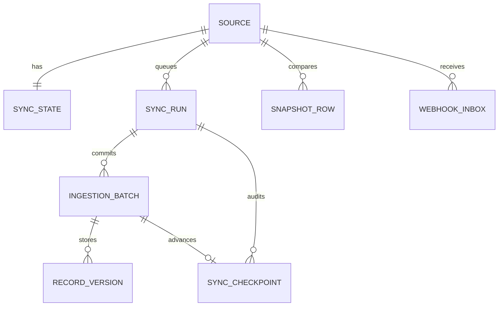

# Data dictionary and ERD

All times use PostgreSQL `timestamptz` and UTC in application code. UUIDs are stored as varchar(36).
Money in raw JSON remains a string/Decimal serialization; no financial arithmetic uses float.
Future core/mart monetary columns must use NUMERIC plus currency, with approved business semantics.

| Table | Grain / key | Purpose |
|---|---|---|
| ops.source_system | One source ID; unique name | Validated connector config with secret references |
| ops.sync_state | One row per source | Live cursor, last success, next sync/reconciliation due |
| ops.sync_runs | One job attempt/recovery ID | Queue state, kind, own cursor, row/retry counters, timestamps |
| ops.sync_checkpoints | One committed ingestion batch | Immutable cursor audit linked to run and batch |
| ops.snapshot_rows | One source + encoded `[shop,key]` | Last observed hash/payload/generation for snapshot diff |
| ops.webhook_inbox | Unique source + provider event ID | Durable validated payload with processed timestamp |
| ops.audit_logs | One administrative action | Actor role, action, resource ID, time; no secrets/payloads |
| raw.ingestion_batches | One committed page | Source, run, received time, page row count |
| raw.record_versions | One distinct scoped payload version | Original JSONB, source timestamp, tombstone, batch lineage |
| mart.pipeline_status_summary | One source (view) | Latest run and source freshness, no raw payload or credentials |

`raw.record_versions.version_hash` is SHA-256 of canonical JSON for ordered sources. Snapshot
versions include an observation generation so delete/re-add events remain visible. Bronze preserves source field names and values, with numeric decimals serialized as strings
to avoid precision loss. It does not retain byte-for-byte HTTP framing or JSON whitespace.
For an identical repeated payload, the original stored batch remains its lineage; subsequent
batch counters/checkpoints record duplicates without storing another payload copy.

Foreign keys connect raw/checkpoint/run/source lineage. Compound identity and run-status indexes
support dedup, source lookup and queue polling. `uq_active_source_run` prevents active overlap even
if enqueue is invoked concurrently. No partitioning is introduced without volume/query evidence.

The `core`, `dq`, and remaining `mart` tables listed in the master prompt are **not yet implemented**.
Their namespaces are reserved by the migration. The migration is frozen and does not import
runtime ORM models, so future model changes cannot silently alter historical migrations.
